# Customer Success Control Tower

A calm, explainable portfolio view for **Microsoft Unified support cases**. It brings the support notifications, case threads and customer meetings a CSAM receives into one local dashboard: what is open, what has closed, what needs a reply, and why a case needs attention.

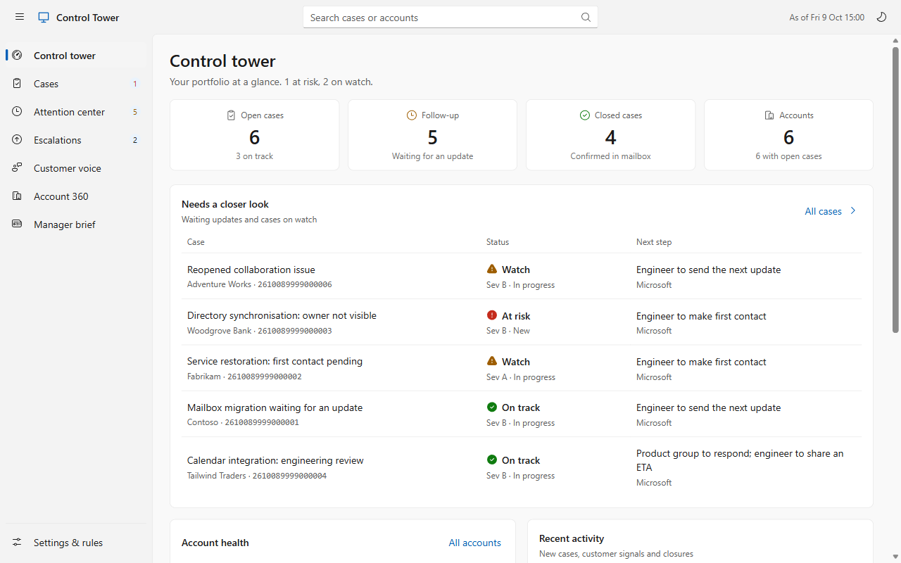

> **Every sample and screenshot in this repository is fictional.** No customer mailbox, real case register, tenant configuration, access token or personal follow-up preferences are included.

## Experience

| Area | What it shows |
| --- | --- |
| **Control tower** | Four essential indicators, cases needing a closer look, account health and recent activity. Trends are available without dominating the page. |
| **Cases** | Open and Closed views, status, next step and activity. Closed records retain people, dates, outcome and the complete available timeline. |
| **Attention center** | A quiet list of cases waiting for a reply, ownership or progress. Select a case to review it; importance, snooze and draft options stay in the detail view. |
| **Account 360** | Account risk, MIRP confirmation/expiry, contacts and commercial context, open cases and clickable case history. |
| **Customer voice** | Complaints, escalation requests and additional asks detected in English/Turkish case threads. |
| **Escalations** | Explainable candidates and recorded critical situations. Proposed actions are not submitted automatically. |
| **Manager brief** | A concise review with decisions, customer voice and follow-ups; copying a brief never sends it. |
| **Settings & rules** | Operational follow-up targets, source limitations, scoring rules and a simulator, outside the daily flow. |

The interface uses familiar Windows/Fluent patterns: restrained colors, consistent typography, readable lists, progressive disclosure, light/dark themes and keyboard navigation. Narrow windows show the same content without hiding the final rows. The deliverable is HTML, not a native WinUI executable.

## Quiet follow-up

The attention center is a **local review queue, not a message bot**.

- Detects missing ownership, an assigned engineer with no personal reply, unanswered customer messages, Microsoft/product-group update delays and reopened cases without a fresh update.
- Counts business hours for normal cases and elapsed 24/7 hours for Sev 1/A. These are operational targets, separate from contractual SLA.
- Groups reasons into one case entry. Repeated customer chasers and automatic notices do not restart the wait.
- Clears the unanswered-message reason when an engineer reply reaches the user's mailbox. Other unresolved reasons can keep the case visible.
- Supports review and snooze for the current episode; a new episode or higher urgency returns to review.
- Keeps drafts and digests preview/copy-only. It does not send e-mail, Teams messages or escalations. Optional Scout reviews are separate.
- Flags incomplete assignment history and unconfirmed closure separately instead of claiming an engineer failed to respond.

Closed/archive notifications are distinguished from **customer-agreed closure pending confirmation** and **inactivity inferred from e-mail**. Reopened cases return to the open view. No technical fix is invented from a generic closure notice.

## Screenshots

All images below were generated from the independently invented mailbox fixture.

| Cases: Open | Cases: Closed |
| --- | --- |
| 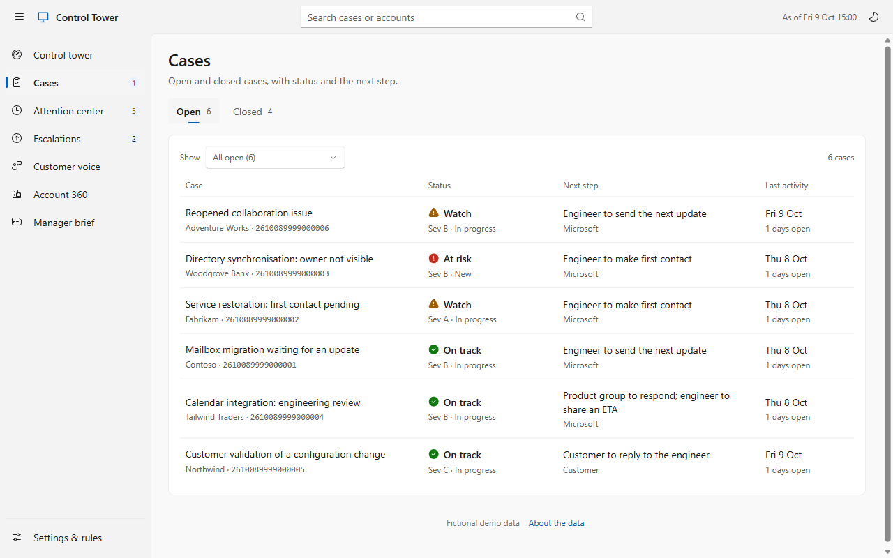 | 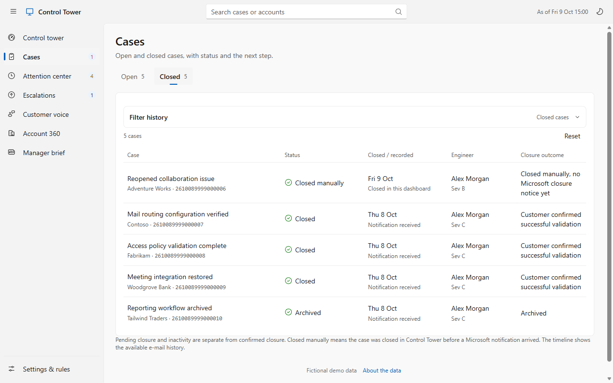 |
| **Attention center** | **Follow-up detail** |
| 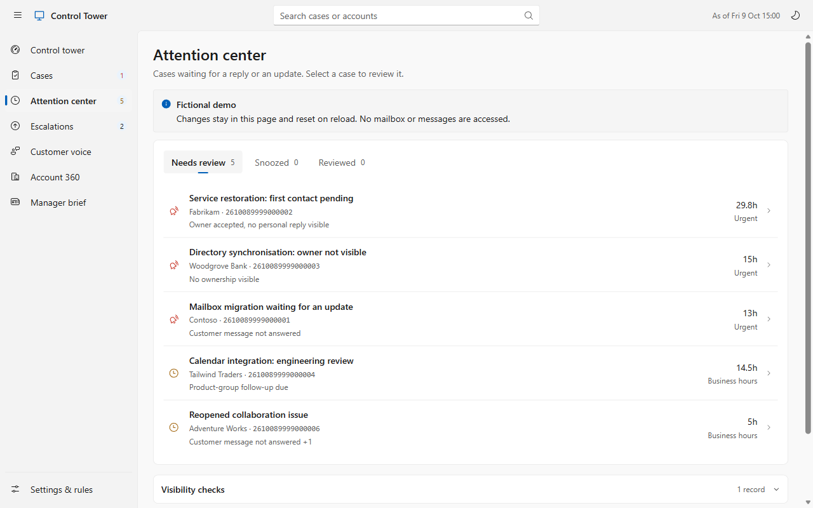 | 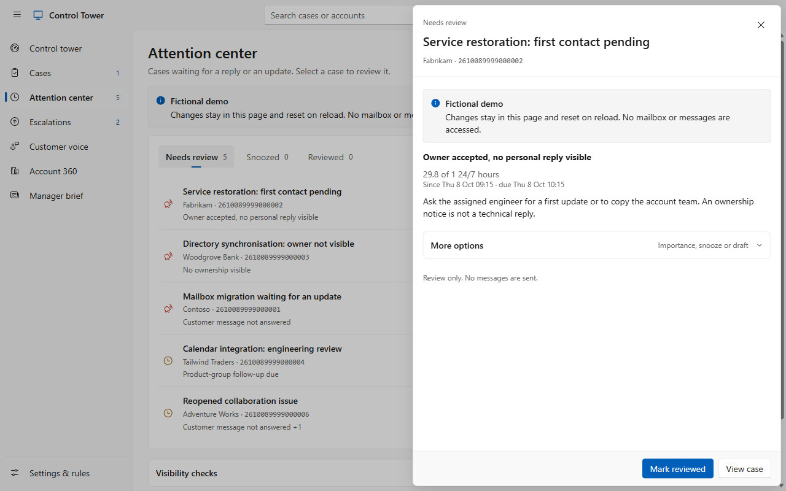 |
| **Case detail** | **Account 360** |
| 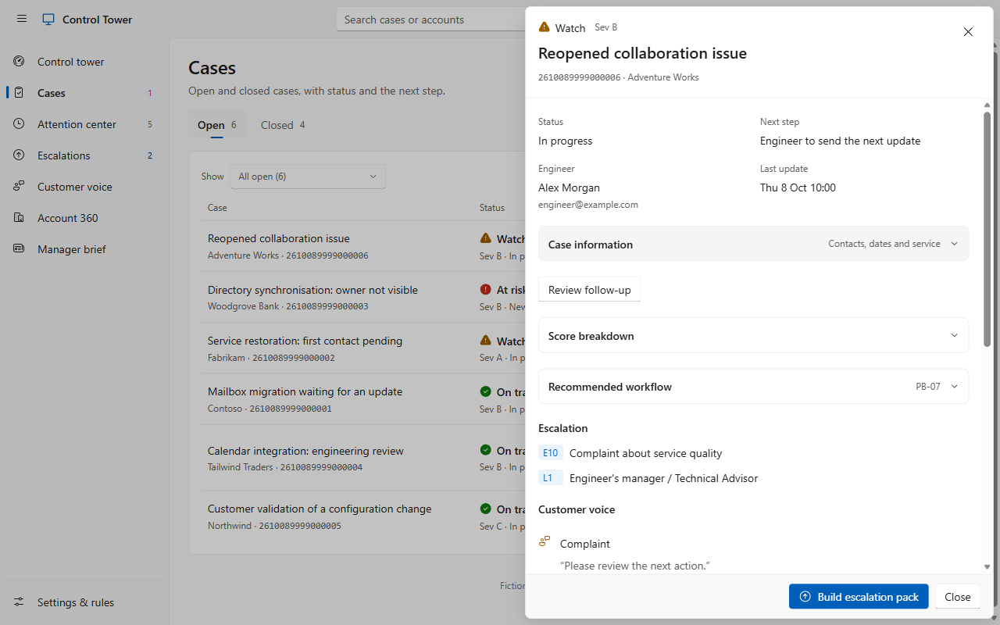 | 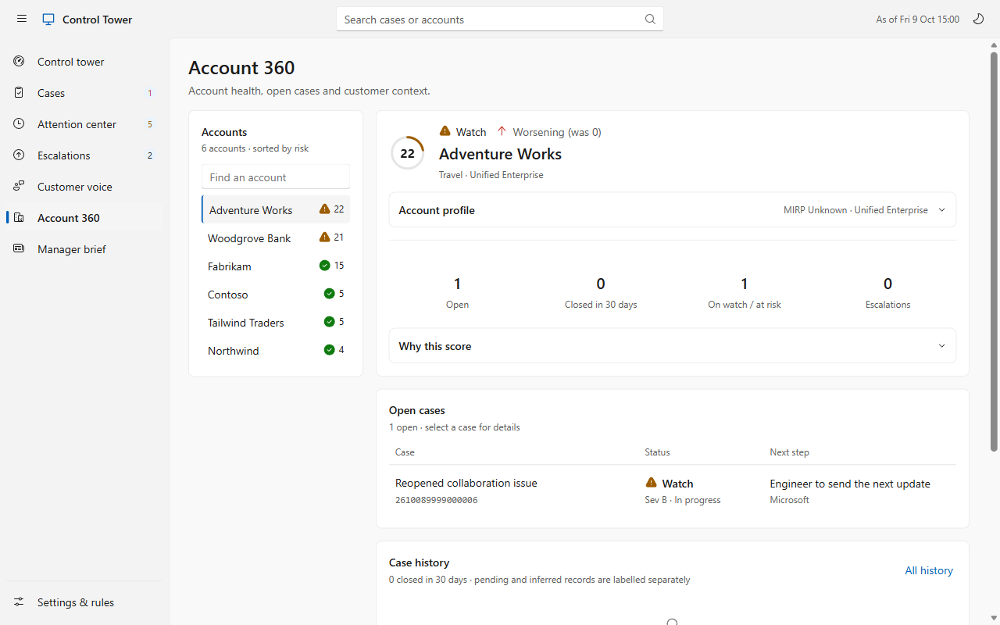 |
| **Customer voice** | **Escalations** |
| 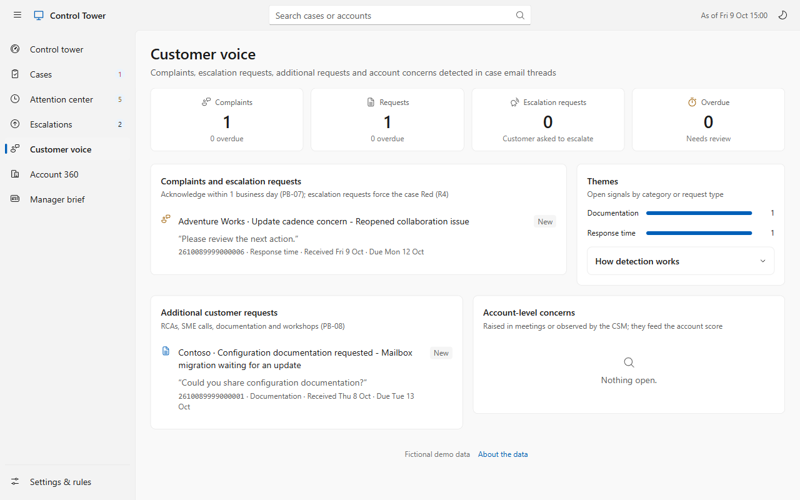 | 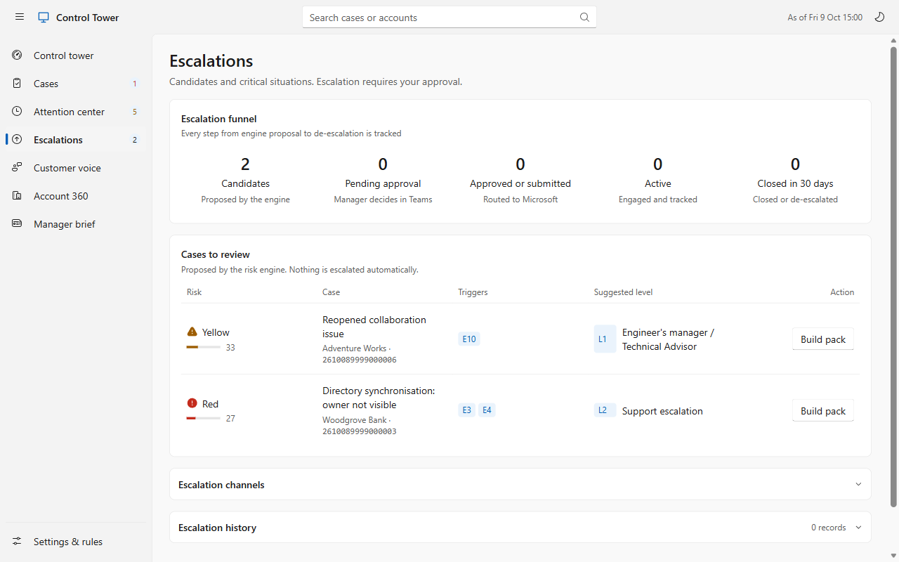 |
| **Manager brief** | **Settings & rules** |
| 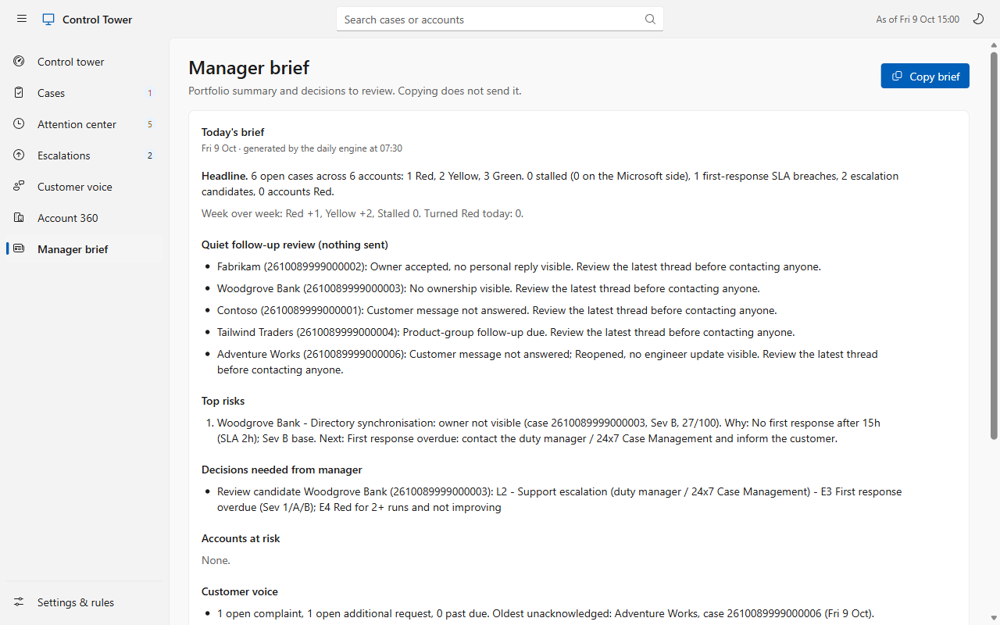 | 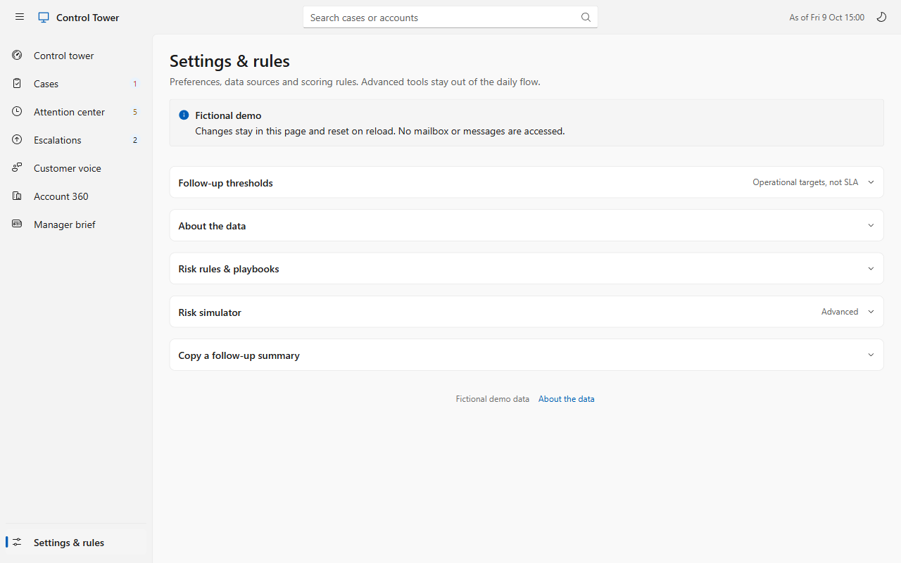 |
| **Dark theme** | **Narrow window** |
| 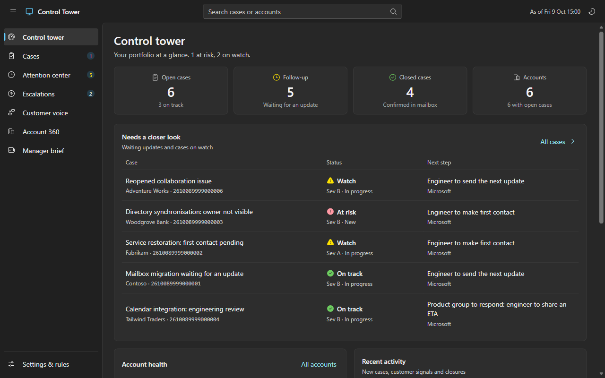 | 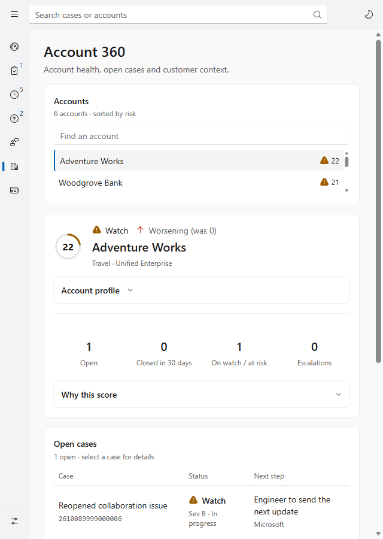 |

## Architecture

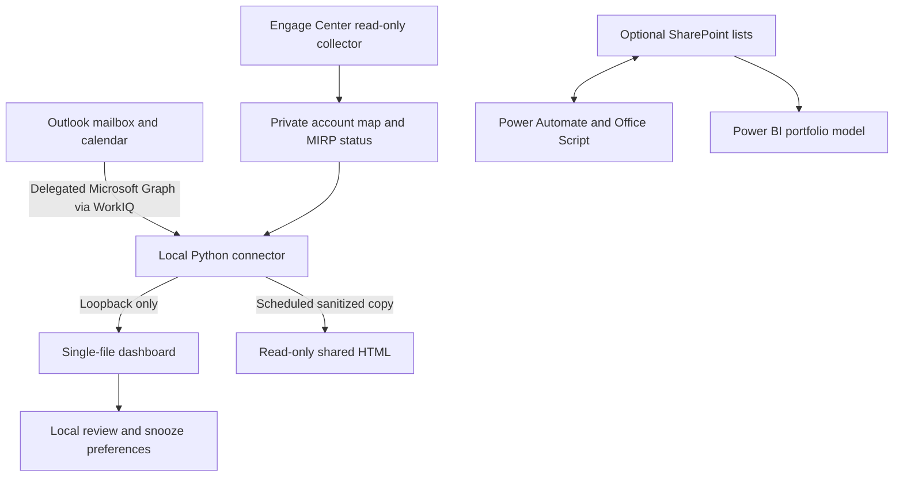

The local dashboard folds the available mailbox events and scores **open cases only**. Closed history is browsable but does not receive a fabricated current risk score. Mailbox events stay in memory; follow-up preferences are a small, separate local file. The shared copy excludes those preferences and cannot expose the user's private attention queue.

The optional Microsoft 365 low-code kit is independent: SharePoint schema/formatting, the scoring engine as an Office Script and a Power BI model. Its approval stages are not inferred from the local mailbox.

## Repository structure

| Path | Contents |
| --- | --- |
| `1-SharePoint/` | Idempotent list provisioning and JSON formatting. |
| `2-PowerAutomate/` | The risk engine as an Office Script. |
| `3-PowerBI/` | Power Query, DAX model/measure definitions and a report theme. |
| `6-SampleData/` | Self-contained interactive demo, fictional mailbox fixture and engine input/output examples. |
| `7-LiveConnector/` | Connector, private-preference module, attention rules, ready-built live dashboard, snapshot template, start/stop scripts and fictional configuration/MIRP templates. |
| `8-SharedDashboard/` | A fictional read-only snapshot example, not a real published dashboard. |
| `tools/` | Portable dashboard builder, invented-fixture generator and the UI/engine/icon sources. |
| `tests/` | Standard-library Python preference/API tests and Node event/rule/history tests. |
| `docs/screenshots/` | Fictional-data screenshots. |

Folders 4 and 5 from the original architecture are not distributed: there is no Teams-card sender or autonomous Copilot agent in this repository.

## Demo

Open [`6-SampleData/customer-success-control-tower-demo.html`](6-SampleData/customer-success-control-tower-demo.html) in Edge or Chrome. The demo contains **12 invented cases across six fictional accounts**, including confirmed closures, pending/inferred closure and several follow-up scenarios. Demo review/snooze changes stay in memory and reset on reload; no Microsoft 365 sign-in or mailbox is accessed.

[`8-SharedDashboard/Customer-Success-Control-Tower-Example.html`](8-SharedDashboard/Customer-Success-Control-Tower-Example.html) shows the read-only sharing experience without private follow-up preferences. Its data is deliberately fixed in time.

## Risk model

| Factor | Cap | Examples |
| --- | ---: | --- |
| Severity | 35 | Sev 1 = 35; A = 22; B = 12; C = 3. |
| Momentum/stall | 30 | Delayed Microsoft updates, customer silence, missing ownership and incomplete visibility. |
| Age | 20 | Age versus severity-specific targets: 3/7/14/30 days for Sev 1/A/B/C. |
| SLA/commitments | 15 | First-response breach/risk, late response, overdue next action and missed ETA. |
| Customer voice | 20 | Frustration/anger, complaints, chasers and overdue requests. |
| Exposure | 15 | Executive visibility, business impact, owner churn, reopening and renewal risk. |

**On track (Green)** is below 30; **Watch (Yellow)** is 30–59; **At risk (Red)** is 60 or above. Hard overrides/floors prevent critical situations, escalation requests or first-response breaches from hiding behind an average score. The full rules, drivers and playbooks remain inspectable in the application.

Account risk combines case exposure, escalations, complaints/requests, CSM concern, renewal, MIRP and product patterns. Follow-up importance changes operational timing only; it never changes support severity or the risk score.

## Privacy and limitations

- Microsoft 365 access uses the signed-in user's own delegated permissions. The connector binds only to loopback; state-changing follow-up requests require the same origin and a custom header.
- Real mailbox data, customer configuration, MIRP results, logs and generated shared dashboards do not belong in source control. Example templates are separate from ignored runtime files.
- `attention-state.json` stores case identifiers, numeric targets, importance and episode review/snooze markers. It does not store e-mail content and is excluded from shared snapshots.
- Shared snapshots omit mailbox/case links, e-mail text and contact addresses by default. Granting file access is a separate user decision.
- Status, next action and customer sentiment are inferred from the available e-mail. A reply that did not reach the user's mailbox cannot clear a wait. No OneSupport records are downloaded.
- The calendar uses a fixed UTC offset and configured holidays; it does not implement daylight saving or guarantee a complete public-holiday calendar.
- The MIRP collector is read-only and does not return, print or save access tokens.

## Tech stack

Python 3 standard library, single-file HTML/CSS/vanilla JavaScript, WorkIQ/Microsoft Graph, TypeScript Office Scripts, SharePoint, Power Automate, Power Query and DAX. Ready-built pages need no package installation or compilation; development sources are included for reproducible builds.
